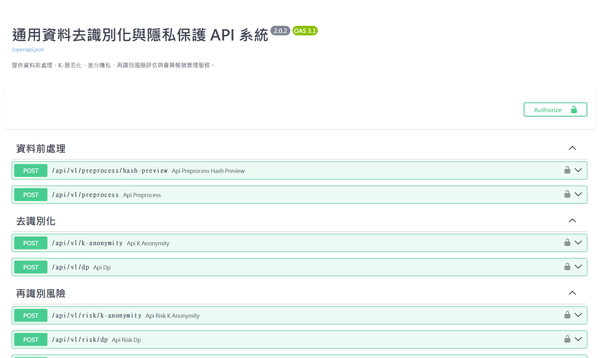

Open-PETs 的處理引擎提供 HTTP API。你可以用 curl、Python 或其他程式語言呼叫，把去識別化整合進自己的系統。API 的帳號和網頁畫面共用同一套。

## 連線位址與互動文件

| 項目 | 線上版 |
| --- | --- |
| API 位址 | `http://<主機>:8080/api/v1`（前端與後端在同一個容器、同一個埠） |
| 互動文件（Swagger UI） | `http://<主機>:8080/docs` |
| API 規格檔（OpenAPI） | `http://<主機>:8080/openapi.json` |
| 連線範圍 | 容器預設只綁本機（`127.0.0.1`）。對外開放時經反向代理走 HTTPS，見[安裝教學第 9 節](../deploy/#9-開放給其他電腦內網與線上) |

- `<主機>` 是部署主機的名稱或 IP；在部署主機本機呼叫時用 `localhost`。對外以 HTTPS 提供時，改用對外網址，例如 `https://pets.example.com/api/v1`。
- **互動文件 `/docs`：** 會列出所有端點與欄位。用法：
    1. 依下方「登入與權杖」取得 access_token。
    2. 按右上角 **Authorize**，貼上 access_token。
    3. 在任一端點按 **Try it out** → **Execute** 就能直接試打。
- `openapi.json` 可以匯入 Postman、Insomnia 等工具。



## 登入與權杖

**1. 登入：** `POST /auth/login`

```http
POST /api/v1/auth/login
Content-Type: application/json

{"username": "帳號", "password": "密碼"}
```

回應：

```json
{
  "access_token": "eyJhbGci…",
  "refresh_token": "O7Wy…",
  "token_type": "bearer",
  "expires_in": 900,
  "username": "owner@test.com",
  "role": "user",
  "message": "登入成功。"
}
```

**2. 之後的每個請求，都在標頭帶上 access_token：**

```http
Authorization: Bearer <access_token>
```

**權杖規則：**

| 項目 | 規則 |
| --- | --- |
| access_token | 有效 15 分鐘（`expires_in = 900` 秒）。沒帶或過期時回 401。 |
| refresh_token | 有效 7 天，每個只能用一次。 |
| 換發權杖 | `POST /auth/refresh`，body 帶 `{"refresh_token": "…"}`，回傳一組新的權杖，舊的 refresh_token 隨即作廢。 |
| 登出 | `POST /auth/logout`，body 帶 `{"refresh_token": "…"}`，作廢該 refresh_token。已發出的 access_token 會在到期前持續有效。 |
| 變更密碼 | `PATCH /auth/password`，body 帶 `{"current_password", "new_password", "refresh_token"}`。保留帶來的這組登入，其他登入一律作廢。 |
| 登入失敗鎖定 | 180 秒內累計失敗 5 次，鎖定 15 分鐘。鎖定期間與密碼錯誤相同，都回 401。 |

## 端點總覽

所有路徑的前綴都是 `/api/v1`。

| 分類 | 方法與路徑 | 用途 | 權限 |
| --- | --- | --- | --- |
| 認證 | `POST /auth/login` | 登入 | 公開 |
| 認證 | `POST /auth/refresh` | 換發權杖 | 公開（需 refresh_token） |
| 認證 | `POST /auth/logout` | 登出 | 公開（需 refresh_token） |
| 認證 | `PATCH /auth/password` | 變更自己的密碼 | 登入 |
| 帳號管理 | `GET /users` | 帳號清單（含失敗次數與鎖定時間） | Admin |
| 帳號管理 | `POST /users` | 建立帳號 `{username, password, role}` | Admin |
| 帳號管理 | `PATCH /users/{帳號}/role` | 變更角色（把 Admin 降級時需帶 `current_password`） | Admin |
| 帳號管理 | `POST /users/{帳號}/reset-password` | 重設密碼並解除鎖定 `{new_password}` | Admin |
| 帳號管理 | `PATCH /users/{帳號}/active` | 啟用或停用 `{is_active}` | Admin |
| 帳號管理 | `DELETE /users/{帳號}` | 刪除帳號 | Admin |
| 設定 | `GET /settings` | 閒置登出時間、密碼長度下限 | 公開 |
| 設定 | `PUT /settings` | 設定閒置登出時間 `{session_timeout_minutes}`（1～1440） | Admin |
| 設定 | `GET`／`PUT /preferences` | 介面偏好（主題、語系、字體大小） | 登入 |
| 去識別化 | `POST /preprocess` | 資料前處理，回傳處理後檔案 | 登入 |
| 去識別化 | `POST /preprocess/hash-preview` | 雜湊預覽（最多 20 個值） | 登入 |
| 去識別化 | `POST /k-anonymity` | K-匿名化，回傳處理後檔案 | 登入 |
| 去識別化 | `POST /dp` | 差分隱私，回傳處理後檔案 | 登入 |
| 風險評估 | `POST /risk/k-anonymity` | 三攻擊風險評估（K-匿名化），回傳 JSON | 登入 |
| 風險評估 | `POST /risk/dp` | 三攻擊風險評估（差分隱私），回傳 JSON | 登入 |
| 風險評估 | `POST /risk/cap` | CAP 前後對比，回傳 JSON | 登入 |
| 報告 | `POST /report` | 由風險報告 JSON 產生 PDF | 登入 |
| 處理紀錄 | `GET /history` | 查詢處理紀錄（Admin 可加 `?all=1` 看所有人） | 登入 |
| 處理紀錄 | `POST /history` | 儲存處理紀錄（需帶處理時取得的 `runId`） | 登入 |
| 處理紀錄 | `GET /history/{id}/verify` | 驗證紀錄簽章 | 本人或 Admin |
| 運算 | `POST /runs/{handle}/cancel` | 取消自己正在執行的運算 | 登入 |

## 呼叫範例：K-匿名化

去識別化端點都用 `multipart/form-data` 上傳兩個欄位：

| 欄位 | 內容 |
| --- | --- |
| `file` | 資料檔：CSV、Excel、JSON 或 JSONL |
| `config` | 統合設定檔（JSON 或 YAML），對應區塊要設 `"enabled": true`。K-匿名化需要 `k_anonymity` 區塊。 |

所有參數都寫在設定檔裡，沒有其他表單欄位。雜湊用的鹽值只從伺服器端的設定讀取（環境變數，或第一次啟動自動產生的 `/data/.secrets.env`），不能由呼叫端指定。範例資料與統合設定檔放在交付套件的 `04_系統設定檔`：`範例資料.csv`、`config_範例_JSON統合版.json`。

### curl（命令提示字元）

以下範例在部署主機上執行；從其他電腦呼叫時，把 `localhost` 換成主機名稱或 IP。

```bat
REM 1. 登入，取得 access_token
curl -X POST http://localhost:8080/api/v1/auth/login ^
  -H "Content-Type: application/json" ^
  -d "{\"username\":\"帳號\",\"password\":\"密碼\"}"

REM 2. 上傳資料與設定檔（把 <access_token> 換成上一步取得的值）
curl -X POST http://localhost:8080/api/v1/k-anonymity ^
  -H "Authorization: Bearer <access_token>" ^
  -F "file=@C:\data\範例資料.csv" ^
  -F "config=@C:\data\config_範例_JSON統合版.json" ^
  -D headers.txt -o anonymized.csv
```


在 PowerShell 中，`curl` 是另一個指令的別名，請改輸入 `curl.exe`，並把行尾的 `^` 換成反引號 `` ` ``。


### Python

```python
import json
import requests

BASE = "http://localhost:8080/api/v1"

# 1. 登入
r = requests.post(f"{BASE}/auth/login", json={"username": "帳號", "password": "密碼"})
r.raise_for_status()
headers = {"Authorization": f"Bearer {r.json()['access_token']}"}

# 2. K-匿名化：上傳資料檔與設定檔
with open("範例資料.csv", "rb") as data, open("config_範例_JSON統合版.json", "rb") as cfg:
    r = requests.post(f"{BASE}/k-anonymity", headers=headers,
                      files={"file": data, "config": cfg})
if r.status_code != 200:
    err = r.json()
    raise SystemExit(f"{r.status_code} {err['error_code']}: {err['message']}")

with open("anonymized.csv", "wb") as out:
    out.write(r.content)
report = json.loads(r.headers["X-Quality-Report"])
print("k 通過：", report["k_passed"], "抑制率：", round(report["suppression_rate_percent"], 1), "%")
print("執行編號：", r.headers["X-Run-Id"])
```

### 回應

| 部分 | 內容 |
| --- | --- |
| 主體 | 處理後的檔案，格式與上傳時相同。檔名為 `anonymized_<原檔名>`（見 `Content-Disposition` 標頭）。 |
| `X-Quality-Report` 標頭 | 品質報告 JSON：`is_valid`、`k_passed`、`l_passed`、`t_passed`、`suppression_rate_percent`、`message`、`recommendations` 等。中文以 `\uXXXX` 編碼。 |
| `X-Run-Id` 標頭 | 本次執行編號。用 `POST /history` 儲存處理紀錄時要帶上它；它在 24 小時內有效，且只能用一次。 |

實際回應標頭節錄：

```http
HTTP/1.1 200 OK
content-type: text/csv; charset=utf-8
content-disposition: attachment; filename="anonymized_sample_2k.csv"
x-quality-report: {"is_valid": true, "k_passed": true, "l_passed": true, "t_passed": true, "suppression_rate_percent": 7.69, …}
x-run-id: 9b17990e9bcb4e848a88c6d29c9eba68
```

## 其他處理端點

| 端點 | 上傳欄位 | 回應 |
| --- | --- | --- |
| `POST /preprocess` | `file`、`config`（`preprocess` 區塊） | 處理後檔案 `preprocessed_<原檔名>` |
| `POST /dp` | `file`、`config`（`differential_privacy` 區塊） | 處理後檔案 `dp_<原檔名>`；預算報告在 `X-Budget-Report` 標頭 |
| `POST /risk/k-anonymity` | `original`、`config`（`risk_attacks` ＋ `k_anonymity`） | JSON：`singling_out_risk`、`linkability_risk`、`inference_risk` 等 |
| `POST /risk/dp` | `original`、`config`（`risk_attacks` ＋ `differential_privacy`） | JSON，格式同上 |
| `POST /risk/cap` | `original`、`processed`、`config`（`risk_cap`） | JSON：CAP 前後對比 |
| `POST /report` | JSON body：`{"task_id", "attack_report", "cap_report"}`（兩份報告至少給一份） | PDF 檔 |

- 想取消一次運算時，可以在請求加上 `X-Client-Run-Id` 標頭（一組 UUID），之後呼叫 `POST /runs/{handle}/cancel` 取消，被取消的請求會回 499。
- 每次成功的處理請求都會回傳 `X-Run-Id` 標頭。

## 錯誤格式與限制

錯誤一律回傳 JSON。`recommendations` 只在系統有建議時才會出現：

```json
{
  "error_code": "ERR_CONFIG_BLOCK_REQUIRED",
  "message": "K-匿名化需要設定檔的 K-匿名化（k_anonymity）區塊，但設定檔沒有這個區塊。請補上區塊內容並把 enabled 設為 true。"
}
```

| 狀態碼 | 常見原因 |
| --- | --- |
| 400 | 參數、設定檔或資料內容有誤 |
| 401 | 沒帶權杖、權杖過期，或帳號密碼錯誤（`ERR_UNAUTHORIZED`） |
| 403 | 權限不足（例如 User 呼叫帳號管理端點） |
| 409 | 資料已存在（例如帳號重複） |
| 413 | 上傳超過上限（預設 1 GB，`OPEN_PETS_MAX_UPLOAD_MB`） |
| 415 | 不支援的檔案或設定檔格式 |
| 422 | 設定檔缺少區塊或與資料不符、抑制比例超過上限 |
| 499 | 運算已被取消 |
| 502／504 | 經反向代理連線時，代理轉不到容器（容器沒有啟動，或代理的上游位址錯誤）；容器本身不會回這兩個狀態 |
| 503 | 沒有設定登入金鑰（`OPEN_PETS_JWT_SECRET`）。容器第一次啟動會自動產生，只有手動把它設成空值或覆蓋掉時才會出現；見[安裝教學第 8 節](../deploy/#8-三種模式本地線上內網) |

**其他限制：**

- 後端一次只執行一個運算，其他請求會排隊等候。
- 處理紀錄單筆上限 256 KB。
- 雜湊預覽一次最多 20 個值，每個值最多 256 個字元。
