本頁說明在瀏覽器中完成一次去識別化的完整流程，以及管理員的帳號管理功能。

## 登入與首頁

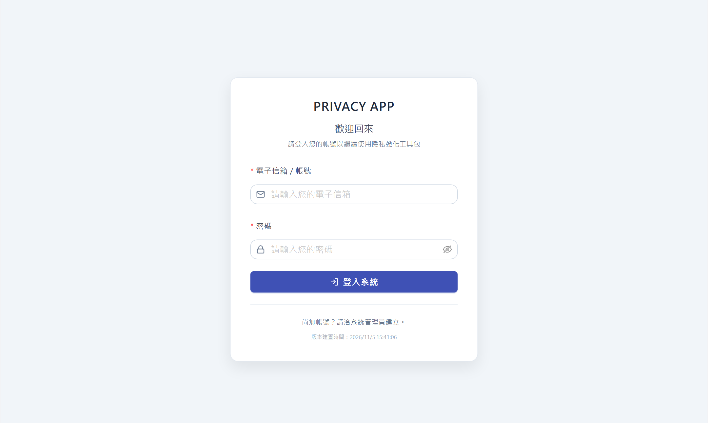

用瀏覽器開啟管理員提供的網址（例如 `http://<主機>:8080`），以管理員建立的帳號與密碼登入。登入後的首頁有三個區塊：

- **新增去識別化任務：** 從這裡開始一次新的處理。
- **本月處理任務數：** 統計本月成功與失敗的件數。
- **最近處理紀錄：** 列出最近幾筆處理。

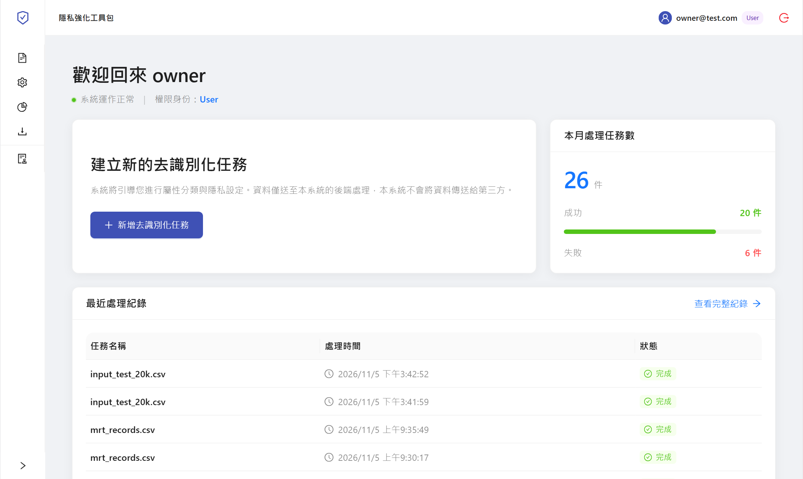

## 流程總覽

四個步驟，達到資料去識別化：

| 步驟 | 名稱 | 做什麼 |
| --- | --- | --- |
| 1 | 上傳資料 | 上傳 CSV 或 Excel，確認預覽，選 K-匿名化或差分隱私 |
| 2 | 欄位設定 | 清理資料，指定每個欄位的角色與處理方式 |
| 3 | 選保護強度 | 選一張保護強度卡片，其餘設定已帶入建議值 |
| 4 | 看結果與交付 | 看結論、再識別風險評估與資料實用性，下載資料與報告 |

- 按「下一步」時，系統會先檢查必填設定。沒通過時，畫面右下角會說明原因。
- 往回走不受限制。
- 按「重新開始」會先請你確認，再清空目前的設定。

---

## Step 1　上傳資料，選保護模式

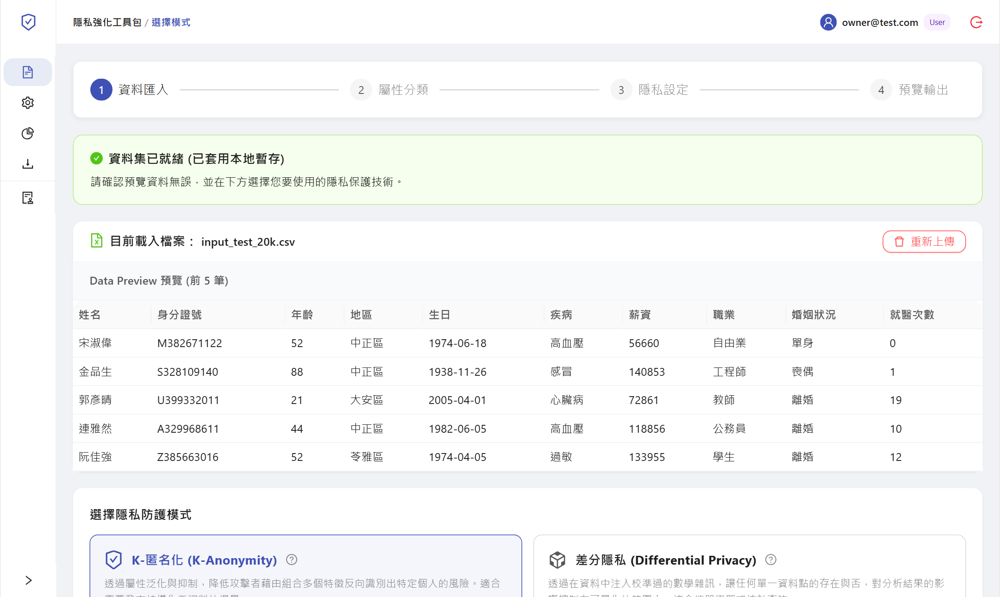

1. **上傳檔案：** 支援 CSV 和 Excel，單檔上限 1 GB、最多 50 個欄位。CSV 如果是 Big5 等非 UTF-8 編碼，系統會自動轉換。
2. **確認已就緒：** 出現綠色的「資料集已就緒」，代表檔案已解析成功。
3. **重新上傳：** 檔案選錯時，可以刪除後重新選擇。
4. **看前 5 筆預覽：** 確認欄位名稱與中文沒有亂碼。

在預覽下方選擇保護模式，選好才能前往 Step 2：

| 模式 | 做法 | 適合情境 |
| --- | --- | --- |
| K-匿名化 | 把可用來認人的欄位變模糊（例：年齡 34 → 30-39），讓這些欄位相同的資料至少有 K 筆 | 要提供逐筆資料給他人、一次性釋出、年度報表 |
| 差分隱私 | 在數值加入經過設計的雜訊，單筆不完全是真值，但整體統計仍接近原貌 | 統計分析、模型訓練、經常重複提供的資料 |

## Step 2　資料預處理與欄位設定（K-匿名化）

### 上半部：資料預處理（兩種模式共用）

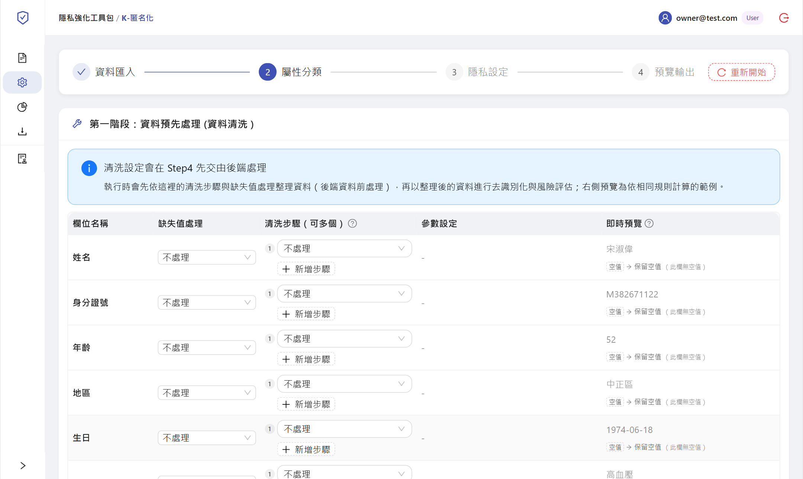

1. **缺失值處理：** 可以不處理、整列丟棄、填固定值，或依平均值等方式填補。資料有極端值時，平均值容易被拉偏。
2. **清洗步驟（可多個）：** 包含去空白、截斷、型態轉換、全半形統一、雜湊。
    - 依編號由上而下執行。
    - 雜湊之後不能再接其他步驟。
3. **即時預覽：** 第一行是範例值處理前後的對照，第二行是空值的處理結果，以及這欄共有幾筆空值。

預覽會即時顯示雜湊後的代碼。

### 下半部：指定角色與處理方式

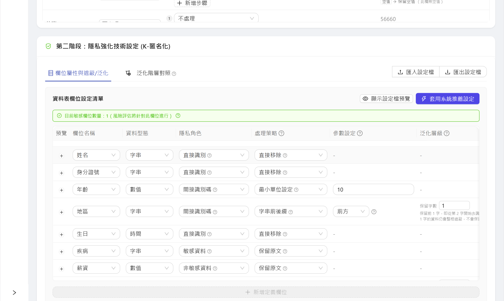

1. **套用系統推薦設定：** 依欄位名稱與內容推薦角色、型態與處理方式，再逐欄檢查。
2. **隱私角色：**

    | 角色 | 意思 | 例子 | 處理方式 |
    | --- | --- | --- | --- |
    | 直接識別 | 單獨就能認出是誰 | 姓名、身分證字號 | 移除、清空或雜湊（假名化） |
    | 間接識別碼 | 單獨不行，組合起來可能認出 | 年齡、生日、地區、職業 | 變模糊（泛化） |
    | 敏感資料 | 要保護、不想被知道的內容 | 疾病、就醫紀錄 | 保留原值，由風險評估把關 |
    | 非敏感資料 | 與認人無關 | 資料來源代碼 | 保留原值 |

3. **處理策略與參數：** 間接識別碼依資料型態選擇變模糊的方式：

    | 資料型態 | 變模糊的方式 | 例子 |
    | --- | --- | --- |
    | 數值 | 最小單位設定，或自訂區間 | 34 → 30-39 |
    | 時間 | 時間粒度（秒、分、時、日、月、年） | 1985-03-12 → 1985 |
    | 類別 | 依階層往上歸類（在「泛化階層對照」分頁設定） | 鄉鎮 → 縣市 |
    | 字串 | 只保留前面或後面幾個字 | 中正區 → 中** |

4. **匯入／匯出設定檔：** 同類型的資料可以重複使用相同設定。


**必要條件：**至少要有 1 個敏感欄位，且不能全部設為「移除」，否則無法進入 Step 3。

日期欄位請把資料型態設為「時間」。設成「數值」時，下一步會說明哪些值無法轉換。


## Step 3　選保護強度（K-匿名化）

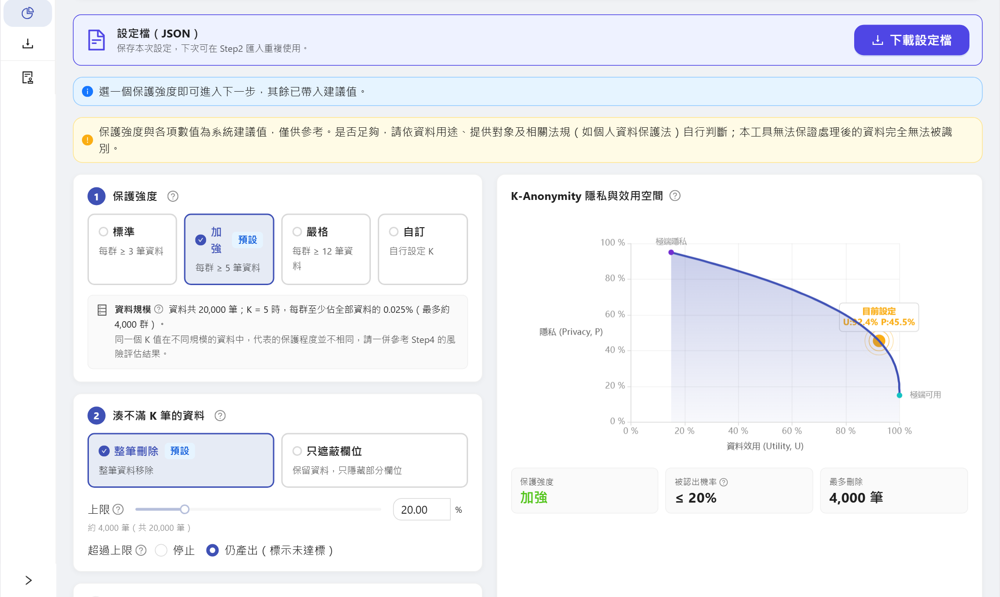

1. **保護強度：**

    | 選項 | K 值 | 被認出機率上限 |
    | --- | --- | --- |
    | 標準 | K = 3 | 33% |
    | 加強（預設） | K = 5 | 20% |
    | 嚴格 | K = 12 | 8% |
    | 自訂 | 自行輸入 | 100 ÷ K % |

    資料筆數不足時，「嚴格」會停用。

2. **湊不滿 K 筆的資料：** 預設整筆刪除，也可以只遮蔽欄位。刪除上限預設 20%，超過時仍會產出資料，但標示為未達標。
3. **隱私與效用空間：** 圖上的橘點標出目前設定在隱私與可用性之間的位置。
4. **下載設定檔：** 保存本次設定，下次在 Step 2 匯入就能沿用。


進階的 l／t 檢查預設關閉。保護強度與各項數值是系統建議值，是否足夠，請依資料用途、提供對象及相關法規自行判斷。


## Step 4　預覽輸出

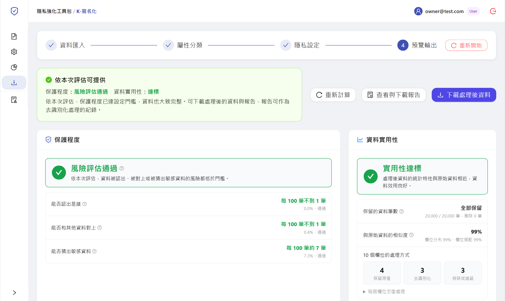

1. **處理結論：** 用一句話說明能不能提供，以及建議的調整方向。
2. **再識別風險評估：** 模擬三種攻擊——能否認出是誰、能否和其他資料對上、能否猜出敏感資料；各項以扣除亂猜基線後的超額風險是否低於 9% 判定通過／不通過。
3. **資料實用性：** 列出保留的筆數、與原始資料的相似度，以及各欄位的處理方式。
4. **重新計算／查看與下載報告／下載處理後資料：** 改過設定後，記得按「重新計算」。

### 結論與風險等級

結論由三項檢查依序決定：去識別化參數（K、l／t、刪除比例；差分隱私為隱私預算）、再識別風險評估、資料實用性。

| 情況 | 畫面結論 | 處理紀錄 | 下載 |
| --- | --- | --- | --- |
| K、l／t、刪除比例或隱私預算未通過 | 處理完成，但未達設定的標準 | 未達標 | 不可 |
| 未完成再識別風險評估 | 處理完成，但未完成風險評估 | 未完成風險評估 | 不可 |
| 再識別風險評估不通過 | 不建議提供 | 未達標 | 不可 |
| 風險評估通過，實用性未達標 | 可以提供，但資料可能不好用 | 達標 | 可 |
| 風險評估通過，實用性達標 | 可以提供 | 達標 | 可 |

- 差分隱私不判定實用性，風險評估通過即為「可以提供」。
- 結論不是「達標」時，不提供處理後資料與 PDF 下載，處理紀錄也無法匯出 PDF。

| 判定 | 三個問題（已扣掉亂猜） | 結果 |
| --- | --- | --- |
| 通過 | 每一項都是每 100 次不到 9 次 | 低於門檻 |
| 不通過 | 任一項達每 100 次 9 次以上 | 未達標，不提供下載 |
| 未完成 | 沒有設定風險評估欄位，或評估失敗 | 未完成風險評估，不提供下載 |
| 依據 | 9% 參考新加坡個資保護委員會的建議 | 國際上用於合成資料的門檻 |

**實用性達標：** 欄位分布與欄位之間的關係都達 75% 以上。風險評估通過，就不必為了更安全而犧牲資料可用性。

**沒達標時，可以依下表的方向調整，再按「重新計算」：**

| 沒通過的項目 | 可以嘗試的方向 |
| --- | --- |
| K 未通過 | 把間接識別欄位分廣泛一點（例：年齡每 5 歲改每 10 歲），或調低 K（保護變弱） |
| l／t 未通過 | 欄位分廣泛一點、調高 K、調低 l，或調高 t |
| 刪除比例超過上限 | 欄位分廣泛一點、調低 K，或調高上限；超過一半時不建議調高上限 |

---

## 差分隱私模式

在 Step 1 選擇「差分隱私」後，Step 2 下半部、Step 3 和 Step 4 會改成以下畫面。Step 2 上半部的資料預處理和 K-匿名化相同。

### Step 2　逐欄決定要不要加雜訊

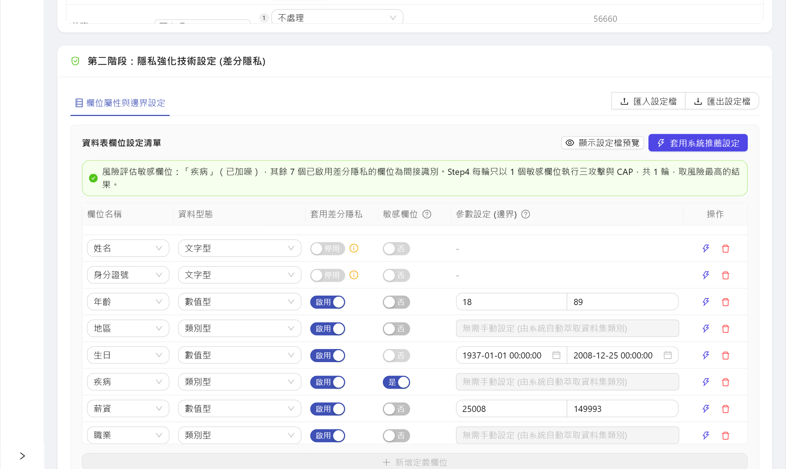

1. **套用系統推薦設定：** 帶入資料型態、加噪開關與上下限，再逐欄檢查。
2. **資料型態：** 數值、類別或文字。日期欄位用日期設定上下限。
3. **套用差分隱私：** 逐欄決定是否加雜訊。
4. **敏感欄位：** 可以複選，系統會逐一評估、取風險最高的結果。文字與日期欄位不能設為敏感欄位。都不選時，系統會輪流評估所有類別欄位，比較耗時。
5. **參數設定（邊界）：** 超出上下限的值會被拉回邊界。類別欄位由系統自動萃取類別。


姓名、身分證號這類文字欄位不會加噪，會原樣輸出。請在 Step 2 上半部用「雜湊」處理這些欄位。


### Step 3　選保護強度，預算自動分配

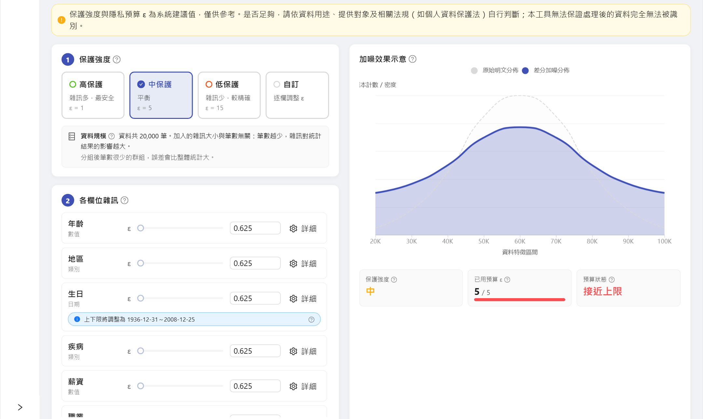

1. **保護強度：** 高保護 ε = 1、中保護 ε = 5、低保護 ε = 15，或選「自訂」逐欄調整。
2. **各欄位雜訊：** 總預算會平均分給已加噪的欄位。例如 ε = 5 分給 8 欄，每欄是 0.625。
3. **加噪效果示意：** 灰色虛線是原始分布，藍色是加噪後的分布。ε 越小，曲線越平。
4. **已用預算／預算狀態：** 顯示 ε 加總佔上限的比例。超過上限時無法進入下一步。


ε 越小，雜訊越多、越安全。雜訊大小與資料筆數無關，所以筆數少時影響較大。


### Step 3　各欄「詳細」設定（一般維持預設即可）

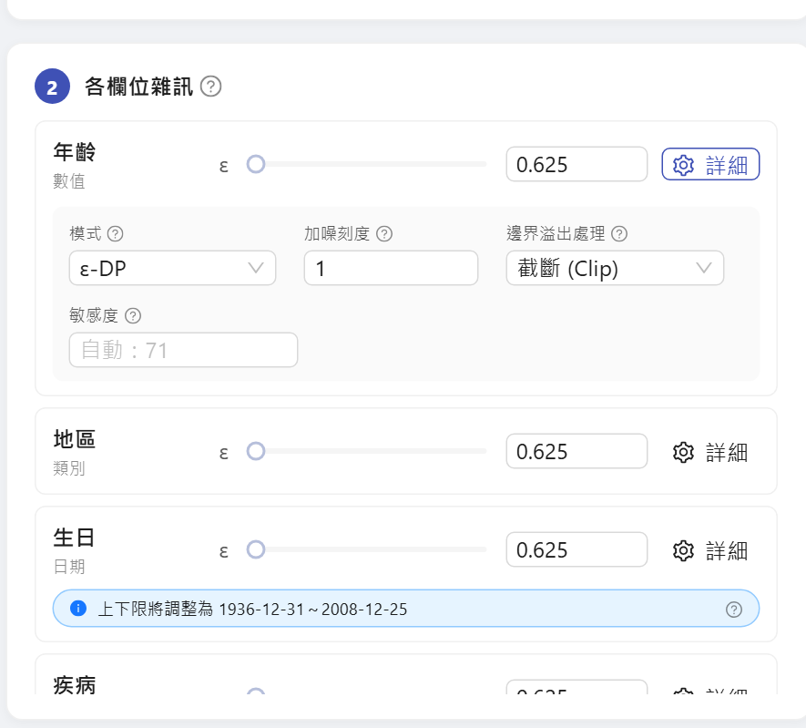

1. **模式：** ε-DP 只用 ε；(ε, δ)-DP 另外容許極小的失效機率 δ，雜訊可以少一些。
2. **加噪刻度：** 加噪後的數值會是這個數字的倍數，1 代表整數。日期欄位改選時間單位。
3. **邊界溢出處理：** 加噪後超出上下限時的處理方式：
    - 截斷：改成邊界值。
    - 環繞：從另一端繞回。
    - 鏡像：從邊界反彈。
4. **敏感度：** 留空時，系統依邊界寬度自動計算，保護最強。調小可以保留較多細節，但保護會變弱。

### Step 4　都通過時，選較大的 ε

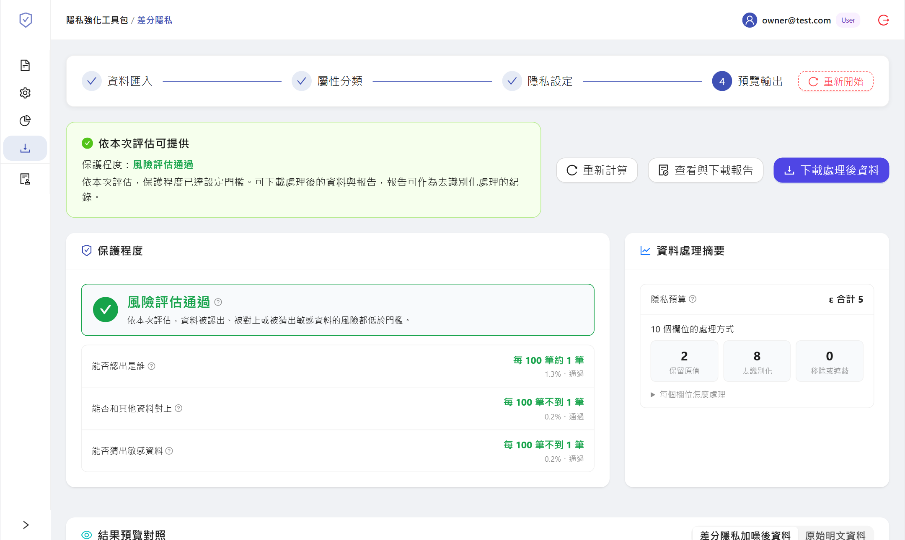

- 結論與風險評估和 K-匿名化相同：三種攻擊，每一項都低於 9% 才算通過。
- 右側卡片改成「資料處理摘要」，顯示隱私預算 ε 合計與各欄處理方式，不顯示實用性等級。
- 同一份資料，ε = 1 和 ε = 15 可能都通過。兩者都夠安全時，選較大的 ε，雜訊比較少，數字也更接近原值。

## Step 3 選填設定（兩種模式共用）

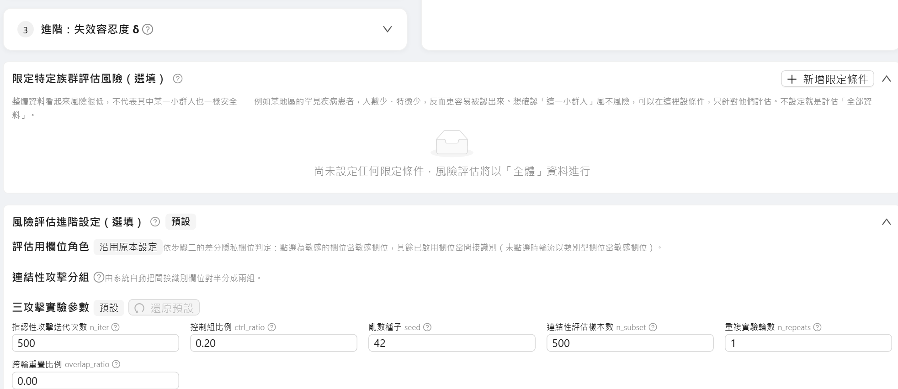

Step 3 下方還有幾個選填區塊，預設都不需要調整。兩張選填卡片預設收合，點標題才會展開。

1. **進階：失效容忍度 δ**（僅差分隱私）：預設不設定，也就是純 ε。
2. **限定特定族群評估風險：** 整體風險低，不代表某一小群人也安全，例如某地區的罕見疾病患者。你可以設定條件，只針對這群人評估。不設定時評估全部資料。
3. **風險評估進階設定：** 包含評估用的欄位角色與連結性攻擊分組，預設沿用 Step 2 的設定。
4. **三攻擊實驗參數：** 包含迭代次數、樣本數、亂數種子等，可以一鍵還原預設。


ε 很小又使用含 δ 的模式時，可能會跑很久。工具會先提醒你，並可改為 ε-DP 執行。遇到逾時訊息時，請等幾分鐘再按，不要連續重按。


---

## 處理紀錄與交付

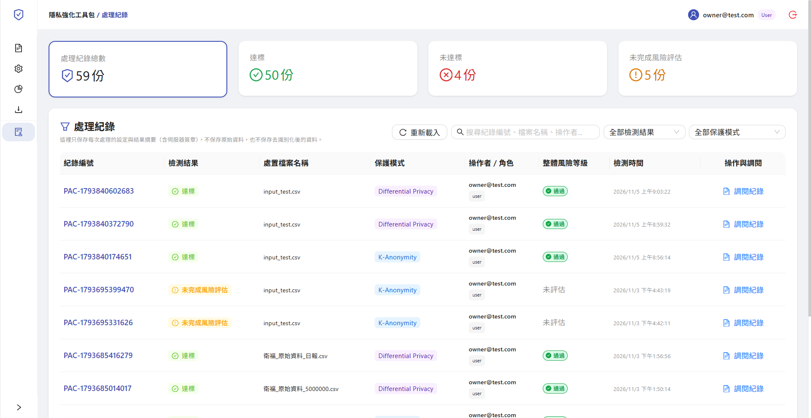

1. **結果統計：** 顯示紀錄總數，以及達標、未達標與未完成風險評估的份數，點選可篩選列表。
2. **搜尋與篩選：** 可依紀錄編號、檔名、操作者、保護模式或檢測結果篩選。
3. **未達標以紅底標示：** 一眼就能找出需要回頭處理的紀錄。
4. **調閱紀錄：** 每筆紀錄都有伺服器簽章，開啟時會自動驗證，也可以再次匯出報告。

處理紀錄只保存設定與結果摘要，不保存原始資料，也不保存去識別化後的資料。

**交付時帶走三樣東西：**

- 處理後資料：下載前會顯示使用注意事項，可以一併下載注意事項文字檔。
- 檢測報告 PDF：列出欄位處理方式、風險評估與實用性結果，可作為去識別化的處理紀錄。
- 設定檔 JSON：下次處理同類資料時，在 Step 2 匯入即可沿用。

**也請提醒資料使用者：**

- K-匿名化資料：區間化後的數字只能做近似分析。被刪除的多是少數族群，小群體的統計可能失真。
- 差分隱私資料：單筆不是真實值，不能用來查個案。最大值、排名、百分位不可靠，小群組的誤差也比較大。

---

## 帳號管理（本版新增）

### 兩種角色

| 角色 | 可以做的事 |
| --- | --- |
| User | 主控台、執行去識別化任務、查看自己的處理紀錄 |
| Admin | 系統管理大廳、帳號與權限管理、閒置登出設定、查看所有使用者的處理紀錄。基於權責分離，Admin 不執行資料處理。 |
| 兩者皆可 | 個人資料與變更密碼、介面偏好設定 |

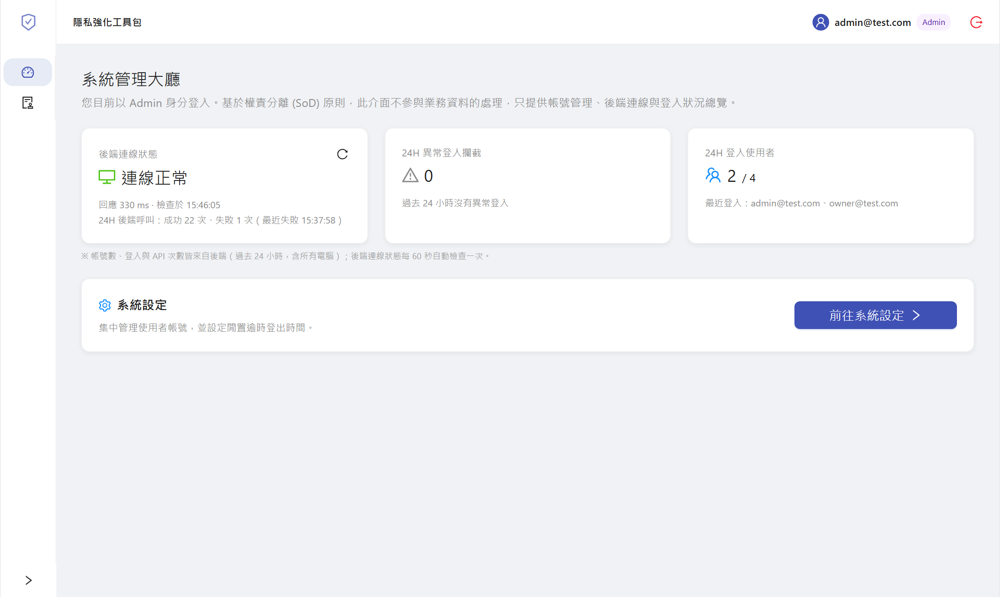

Admin 登入後會進入「系統管理大廳」，可以一次看到後端連線狀態、24 小時內的異常登入，以及登入使用者數。

### 帳號與權限管理

路徑：系統設定 → 帳號與權限管理

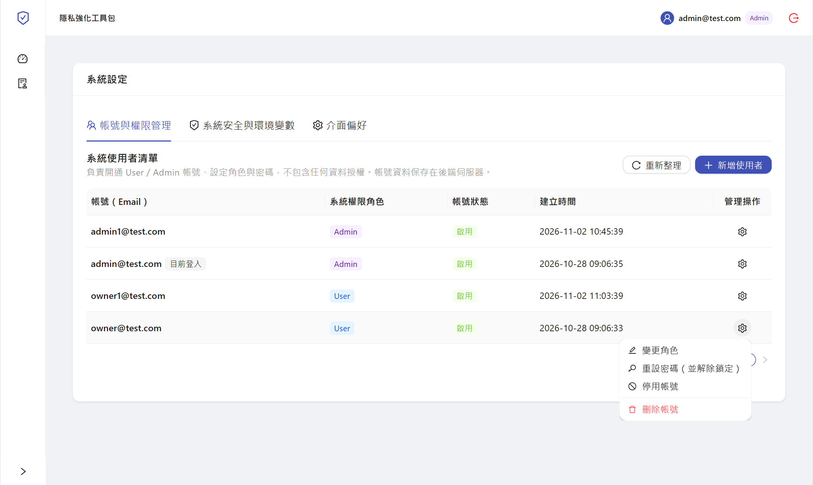

1. **新增使用者：** 輸入 Email、初始密碼與角色。請把初始密碼交給對方，並提醒他登入後到「個人設定」自行變更。

    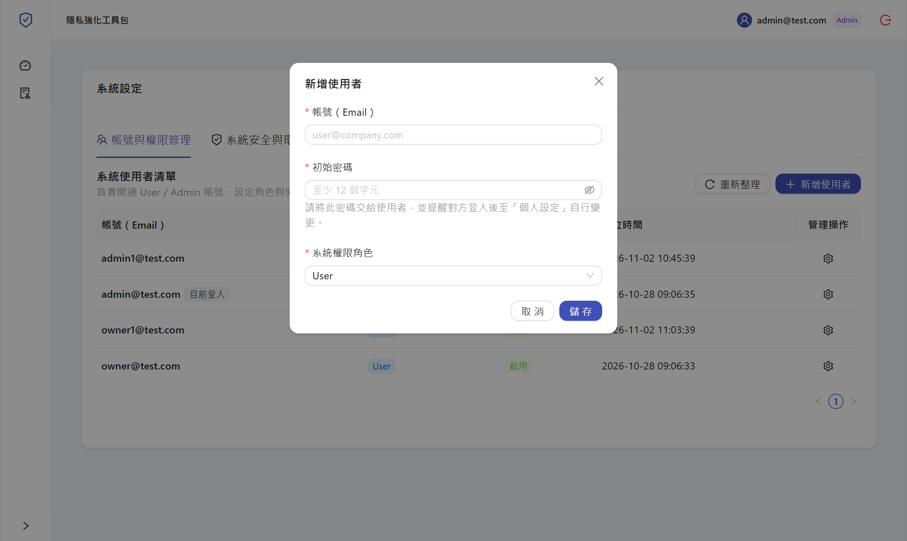

2. **帳號狀態：** 一欄看清楚帳號是啟用、停用，還是鎖定中。
3. **管理選單（每列右側齒輪）：** 變更角色、重設密碼（並解除鎖定）、停用帳號、刪除帳號。

**系統防呆：**

- 至少要保留一個啟用中的 Admin。
- 不能停用、刪除自己，也不能變更自己的角色。
- 把 Admin 降為 User 時，要輸入自己的密碼。
- Admin 的密碼不能由他人重設，請 Admin 自行在「個人設定」變更。

### 登入失敗鎖定與閒置登出

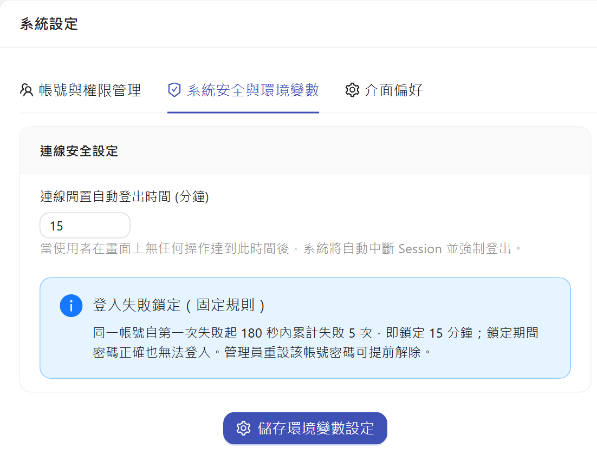

- **登入失敗鎖定（固定規則）：** 同一帳號從第一次失敗起，180 秒內累計失敗 5 次，就會鎖定 15 分鐘。鎖定期間即使密碼正確也無法登入。管理員重設該帳號的密碼，可以提前解除鎖定。
- **閒置自動登出：** 管理員在「系統安全與環境變數」設定，範圍是 1～1440 分鐘。不論是手動登出、閒置逾時或登入逾期，登出時都會清除工作區與已上傳的檔案。

### 密碼規則與介面偏好

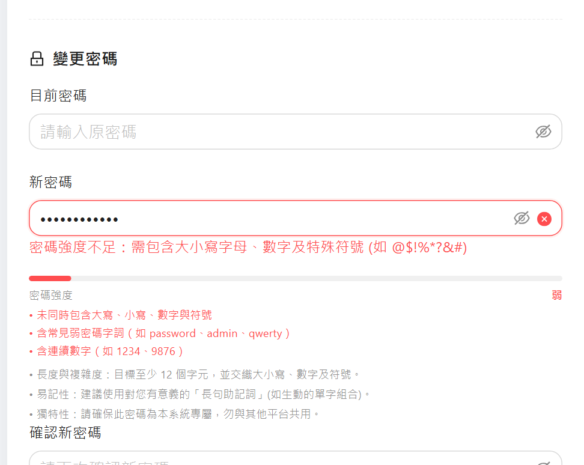

- **密碼規則：** 至少 12 個字元，並同時包含大寫、小寫、數字與符號。輸入時，強度條會即時列出偏弱的原因。
- **變更密碼：** 會保留目前這次登入，其他裝置上的登入則會被登出。
- **介面偏好：** 外觀主題、語系、字體大小會依帳號記住，換電腦登入也一樣。

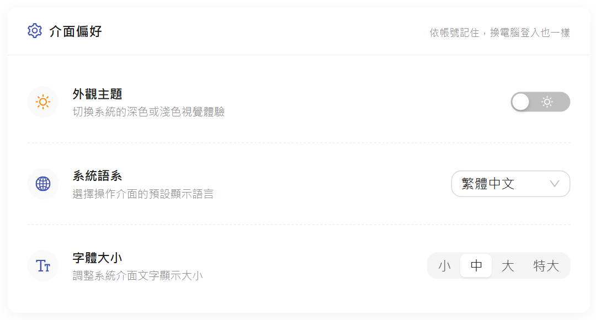


帳號也可以用命令列建立或重設密碼，請見 [命令列使用說明](../cli/)。

