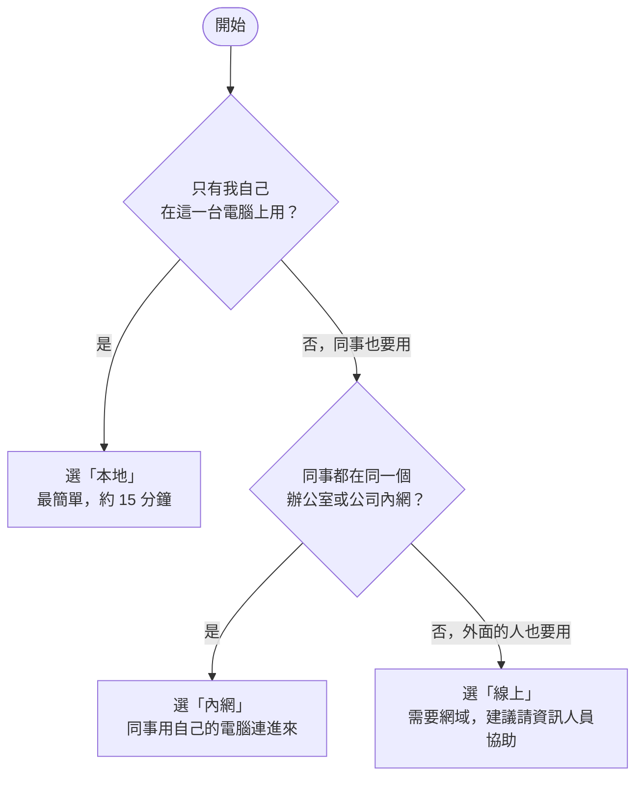

這一頁寫給**第一次安裝、不熟電腦指令**的人。照著做，約 15 到 30 分鐘就能在自己的電腦裝好 Open-PETs 並開始使用。每一步都會告訴你「這一步在做什麼」「你應該看到什麼」「看到錯誤怎麼辦」。


**目前的最新版本是預發版 `2.0.0-rc3`**（正式版尚未發佈）。下面的指令都已經寫好這個版本號，直接複製貼上即可。之後有新版本時，把版本號換掉就好。


## 先看這一頁：你需要知道的名詞

不用背，遇到再回來查。

| 名詞 | 白話意思 |
| --- | --- |
| **Docker Desktop** | 一個免費的小程式，讓你的電腦可以「執行打包好的軟體」。Open-PETs 就是用它執行的。 |
| **映像檔、容器** | 映像檔是「打包好的軟體」，容器是「正在執行的軟體」。你只需要知道：容器開著，Open-PETs 才能用。 |
| **PowerShell** | Windows 內建的「打字下指令」的視窗。開始功能表搜尋「PowerShell」就找得到。 |
| **IP 位址** | 電腦在網路上的門牌號碼，長得像 `192.168.1.20`。同事要用這個號碼找到你的電腦。 |
| **埠（Port）** | 同一台電腦上的「門號」。例如網址 `localhost:8080` 的 8080 就是埠。 |
| **HTTPS 與憑證** | 讓網路上傳送的資料加密的機制，網址開頭是 `https://`。憑證像是「身分證」，瀏覽器靠它確認連到的是對的網站。 |
| **反向代理** | 放在系統前面的一道「櫃台」，負責把外面來的連線轉進來，並處理 HTTPS。只有「線上」模式需要自備。 |
| **管理員帳號** | 第一個帳號，用來登入並替其他人建立帳號。系統不開放自行註冊。 |

**你需要準備：**

- 一台 Windows 10 或 11 的電腦（Linux 也可以，指令見各步驟的 Linux 頁籤）。
- 第一次安裝需要連網路下載；沒有網路的環境，請拿「離線交付包」，見[步驟 2](#步驟-2準備所有模式都一樣)。
- 可以安裝程式的權限。公司電腦如果不能自己裝軟體，請先請資訊人員協助安裝 Docker Desktop。


Docker Desktop 對個人、教育與小型企業免費；較大的公司使用需要付費授權。**公司電腦請先向資訊人員確認授權。**


## 步驟 1：我該選哪一種模式？

Open-PETs 有三種使用方式。**只要回答三個問題**：



| | 本地 | 內網 | 線上 |
| --- | --- | --- | --- |
| 誰會用 | 只有你自己 | 同一個辦公室／內網的同事 | 網際網路上的人 |
| 網址長怎樣 | `http://localhost:8080` | `https://192.168.1.20`（這台電腦的 IP） | `https://pets.你的網域.com` |
| 需要準備 | Docker Desktop | Docker Desktop、這台電腦要常開機、IP 固定 | 另外還要有網域、反向代理、正式憑證 |
| 同事要做的事 | 不適用 | 每台電腦第一次要「信任憑證」（約 2 分鐘） | 不用做什麼 |
| 難度 | ★ | ★★ | ★★★ |
| 之後可以改嗎 | 可以，隨時切換 | 可以 | 可以 |


**不確定的話，先選「本地」。** 它最簡單，而且之後只要一行指令就能改成「內網」或「線上」，你的資料、帳號都會保留。


## 步驟 2：準備（所有模式都一樣）

### 2-1. 安裝 Docker Desktop

1. 到 https://www.docker.com/products/docker-desktop/ 下載 Docker Desktop 並安裝。安裝時如果問你要不要用 WSL 2，選「是」（預設）。
2. 安裝完成後**重新開機**，開啟 Docker Desktop。
3. 等視窗左下角出現綠色的 **Engine running**。剛開機時可能要等一兩分鐘。

**你應該看到：** Docker Desktop 視窗左下角是綠色的「Engine running」。
**看到別的：** 如果是黃色（Starting）就再等一下；如果一直是紅色或跳出錯誤，重開機再試，或請資訊人員協助。

### 2-2. 建立資料夾並取得工具

Open-PETs 附了一個小工具 `open-pets.ps1`，用問答幫你完成安裝與切換模式，不用自己改設定檔。


**請用一個全新的資料夾**（下面用 `C:\open-pets-app`）。如果你這台電腦之前裝過舊版 Open-PETs（資料夾叫 `C:\open-pets`），**不要用同一個資料夾**，否則可能覆蓋掉舊版的金鑰設定。




開啟 PowerShell（開始功能表搜尋「PowerShell」，點「Windows PowerShell」），一行一行貼上並按 Enter：

```powershell
New-Item -ItemType Directory -Force C:\open-pets-app | Out-Null
cd C:\open-pets-app
$v = '2.0.0-rc3'
Invoke-WebRequest -UseBasicParsing "https://github.com/ttcdog115016/Demo/releases/download/v$v/open-pets.ps1" -OutFile open-pets.ps1
Unblock-File .\open-pets.ps1
```

**這幾行在做什麼：** 建立資料夾、進到那個資料夾、從 GitHub 下載工具，並告訴 Windows 這個檔案可以執行。

**你應該看到：** 沒有任何錯誤訊息，資料夾裡多了 `open-pets.ps1`（用 `dir` 可以看到）。


```bash
mkdir -p ~/open-pets-app && cd ~/open-pets-app
v=2.0.0-rc3
curl -fsSLO "https://github.com/ttcdog115016/Demo/releases/download/v$v/open-pets.sh"
chmod +x open-pets.sh
```

之後的指令把 `.\open-pets.ps1` 換成 `./open-pets.sh`，把 `-Hosts` 這類參數換成 `--hosts`。



**如果出現「因為這個系統上已停用指令碼執行，所以無法載入…」：** 這是 Windows 的安全設定，改用下面這種寫法執行工具（只對這一次有效，不會改系統設定）：

```powershell
powershell -ExecutionPolicy Bypass -File .\open-pets.ps1 setup
```

**拿到的是「離線交付包」（沒有網路的環境）：** 把整個資料夾複製到電腦上，在該資料夾開啟 PowerShell（資料夾空白處按住 Shift 再按右鍵 → 在此處開啟 PowerShell 視窗），資料夾裡已經有工具和映像檔，不用下載，直接做下一步。

## 步驟 3A：本地模式（只有你自己用）

### 做法

在安裝資料夾的 PowerShell 執行：

```powershell
.\open-pets.ps1 setup
```

工具會一步一步問你。**你只要依照畫面回答**：

| 工具問你 | 你怎麼回答 |
| --- | --- |
| 請選擇你要怎麼使用 Open-PETs | 輸入 `1`（本地），按 Enter |
| 要安裝哪一版（如果有問） | 輸入 `2.0.0-rc3`，按 Enter |
| 請確認…要開始安裝嗎 | 看一下內容，輸入 `Y`，按 Enter |
| 建立第一個管理員：帳號、密碼 | 帳號建議用你的 Email；密碼至少 12 個字元，要同時有大寫、小寫、數字與符號（輸入時畫面不會顯示字，是正常的），再輸入一次確認 |

**第一次下載映像檔需要幾分鐘**，畫面會一直在跑，請耐心等。

### 你應該看到

```text
== Open-PETs 安裝
  [完成] Docker 正在運作
...
== 啟動
  等待系統就緒.....
  [完成] 系統已經就緒

== 怎麼開啟
  在這台電腦的瀏覽器開：http://localhost:8080
  只有這台電腦連得進來。
```

接著在瀏覽器（Chrome 或 Edge）輸入 **http://localhost:8080**，用剛才建立的管理員帳號登入。登入後怎麼使用，見[前端操作說明](../frontend/)。


如果工具說「8080 埠已經有別的程式在用，改用 8081」，網址就改成 `http://localhost:8081`。工具會在最後一段「怎麼開啟」寫出正確的網址。


### 看到錯誤怎麼辦

| 你看到 | 原因 | 怎麼辦 |
| --- | --- | --- |
| `Docker 沒有在執行（連不到 Docker 引擎）` | Docker Desktop 沒開，或還沒準備好 | 開啟 Docker Desktop，等左下角綠色 Engine running，再重新執行 `.\open-pets.ps1 setup` |
| `找不到 Docker` | 還沒安裝 Docker Desktop | 回到[步驟 2-1](#2-1-安裝-docker-desktop) |
| `下載映像檔失敗` | 沒有網路，或版本號打錯 | 確認可以上網；版本請填 `2.0.0-rc3`（不含開頭的 v） |
| `這台電腦上已經有一個叫「open-pets」的容器…新的會改叫「open-pets-app」` | 這台電腦之前裝過舊版 | 不是錯誤，工具已經自動避開，不會動到舊的 |
| 瀏覽器打不開 `localhost:8080` | 埠被改了，或系統還沒就緒 | 執行 `.\open-pets.ps1 status` 看正確的網址與狀態 |
| 登入頁沒有帳號可以選 | 還沒建立管理員 | 執行 `.\open-pets.ps1 create-admin` |

## 步驟 3B：內網模式（同一個辦公室的同事一起用）

### 開始之前，先確認

- 這台電腦要**一直開機**（同事才連得到），並且連在跟同事**同一個內網**。
- 這台電腦的 **IP 最好固定**。IP 變了，同事就連不上。請資訊人員幫你在路由器設定「DHCP 保留」，或在這台電腦的網路設定固定 IP。
- 準備好要給同事用的帳號（管理員登入後，在「系統設定 → 帳號與權限管理」建立）。

### 做法

**1. 安裝。** 在安裝資料夾的 PowerShell 執行：

```powershell
.\open-pets.ps1 setup
```

| 工具問你 | 你怎麼回答 |
| --- | --- |
| 請選擇你要怎麼使用 Open-PETs | 輸入 `2`（內網） |
| 網址（同事要用哪個網址連進來） | 工具會列出這台電腦偵測到的內網 IP，**直接按 Enter 用第一個**，或輸入你要的（例如 `192.168.1.20`）。有內網主機名稱的話，用逗號接在後面，例如 `192.168.1.20,pets-server` |
| 要開始安裝嗎 | 輸入 `Y` |
| 建立第一個管理員 | 同本地模式 |

**2. 開放防火牆。** 工具最後會印出一行 `New-NetFirewallRule ...` 的指令，那是讓同事的電腦能連進這台電腦的設定。請用「系統管理員身分」再開一個 PowerShell（開始功能表搜尋 PowerShell → 對「Windows PowerShell」按右鍵 → 以系統管理員身分執行），把那一行貼上執行。

**3. 產生憑證與給同事的說明。** 回到安裝資料夾的 PowerShell 執行：

```powershell
.\open-pets.ps1 export-ca
```

**你應該看到：**

```text
  [完成] 已匯出憑證：C:\open-pets-app\open-pets-ca.crt
  [完成] 已產生給同事的說明：C:\open-pets-app\open-pets-colleague-guide.txt
  憑證 SHA-256 指紋：7E9539E6...
```

**4. 把這兩個檔案交給同事**（隨身碟、內部檔案伺服器、Email 都可以）：

- `open-pets-ca.crt`：憑證
- `open-pets-colleague-guide.txt`：給同事的一頁說明（裡面已經寫好網址、信任憑證的步驟和要核對的指紋）

**5. 同事做一次「信任憑證」。** 這是為什麼：Open-PETs 的 HTTPS 憑證是公司內部自己簽發的，瀏覽器預設不認識，所以第一次會跳出警告。信任後就不會再出現。同事照 `open-pets-colleague-guide.txt` 做即可，大意是：

1. 把 `open-pets-ca.crt` 存到自己的電腦。
2. 用系統管理員身分開 PowerShell，執行 `certutil -addstore -f Root open-pets-ca.crt`。
3. 完全關閉瀏覽器再重開。
4. 開啟 `https://192.168.1.20`，網址列出現鎖頭，就成功了。**網址要換成你自己的**：就是步驟 1 裡回答「網址」那一題填的（或 `-Hosts` 帶的值）；忘了的話，在安裝資料夾執行 `.\open-pets.ps1 status` 就會列出來。同事輸入清單以外的網址會連不上。

**同事的電腦沒有系統管理員權限怎麼辦？** 請資訊人員用群組原則把 `open-pets-ca.crt` 一次佈署到所有電腦。


**憑證的指紋要核對。** 說明檔裡有一串 SHA-256 指紋，同事雙擊 `open-pets-ca.crt` →「詳細資料」→「指紋」，要跟說明檔一致才安裝。這是為了防止檔案在傳送過程被人掉包。


### 看到錯誤怎麼辦

| 你／同事看到 | 原因 | 怎麼辦 |
| --- | --- | --- |
| 瀏覽器顯示「您的連線不是私人連線」 | 這台電腦還沒信任憑證 | 照上面第 5 步做一次 |
| 同事連不上，一直轉圈圈或「無法連線」 | 防火牆沒開，或這台電腦沒開機 | 確認第 2 步已經執行；在同事電腦的 PowerShell 執行 `Test-NetConnection 192.168.1.20 -Port 443`，要顯示 `TcpTestSucceeded : True` |
| 同事連進來出現 `ERR_SSL_PROTOCOL_ERROR`（SSL 錯誤）或憑證名稱不符 | 同事輸入的網址不在你填的清單裡（例如你只填 IP，同事卻輸入電腦名稱） | 執行 `.\open-pets.ps1 mode lan -Hosts 192.168.1.20,pets-server`，把同事會用的網址都列進去，再 `export-ca` |
| 工具說「443 埠已經有別的程式在用，HTTPS 改用 8443」 | 這台電腦的 443 被別的程式占用 | 不是錯誤，但同事的網址要加上埠：`https://192.168.1.20:8443`，防火牆也要開 8443 |
| 這台電腦重開機後 IP 變了 | IP 沒固定 | 把 IP 固定後，執行 `.\open-pets.ps1 mode lan -Hosts 新的IP`，並重新執行 `export-ca` 給同事新的說明 |

## 步驟 3C：線上模式（讓外面的人用）

**先說清楚：** 線上模式是把系統放到網際網路上，需要有**自己的網域**（例如 `pets.example.com`）、**反向代理**和**正式的 HTTPS 憑證**，並且要處理網路對外開放的資安問題。**我們建議請資訊人員協助。** 如果只是公司內部使用，請改選「內網」。

### 事前要有

1. **一個網域**，並且把它指向這台電腦對外的 IP（或你的雲端主機）。
2. **一個反向代理**（Caddy 或 nginx 都可以，交付包有範例），負責 HTTPS 與正式憑證。
3. 路由器／防火牆對外開放 80 與 443 埠，並轉到反向代理所在的電腦。

### 做法

1. 在安裝資料夾執行 `.\open-pets.ps1 setup`，選 `3`（線上），**網域**填你的網域（例如 `pets.example.com`，不含 `https://`）。
2. 工具只會把 Open-PETs 本身設定成線上模式（應用程式只在這台電腦的 `127.0.0.1` 運作）。**反向代理要你自己設**：把範例檔 `Caddyfile.example`（或 `nginx.conf.example`）裡的 `openpets.example.com` 換成你的網域，並轉送到 `127.0.0.1:8080`（工具最後的「怎麼開啟」會寫出實際的埠）。
3. 反向代理設定好後，用瀏覽器開 `https://你的網域`。


**不要把應用程式的埠（8080）直接對外開放。** 一定要經過有 HTTPS 的反向代理，否則帳號密碼會以明文在網際網路上傳送。完整的反向代理設定與檢查清單見[安裝教學第 9-6 節](../deploy/#9-6-線上模式online對外網域)。


## 步驟 4：三種模式之間怎麼切換

**一行指令就能切換，資料不會不見**（帳號、處理紀錄、稽核紀錄、金鑰都存在 Docker 的「資料磁碟區」，切換模式只是改設定並重啟）。

```powershell
.\open-pets.ps1 mode local      # 切到「本地」
.\open-pets.ps1 mode lan        # 切到「內網」
.\open-pets.ps1 mode online     # 切到「線上」
```

切換前，工具會先用白話告訴你「切換之後會發生什麼」，並問你要不要繼續（輸入 `Y` 才會做）。如果新模式需要網址，而你沒給，工具會問你。

### 切換前先看這張表

| 從 → 到 | 會發生什麼 | 你要做什麼 |
| --- | --- | --- |
| 本地 → 內網 | 同事可以用 `https://內網IP` 連進來；多一個 HTTPS 容器 | 開防火牆（工具會印出指令）；執行 `export-ca`，把憑證與說明交給同事；同事做一次「信任憑證」 |
| 內網 → 本地 | 同事**立刻連不上**；只剩這台電腦能用；HTTPS 容器停掉（憑證資料保留） | 先通知同事。之後想再切回內網，憑證沿用，**同事不用重新信任** |
| 本地 → 線上 | 應用程式變成線上模式；本機之外的人要經反向代理才連得到 | 準備網域、反向代理與正式憑證（見步驟 3C） |
| 內網 → 線上 | 內網的 HTTPS 容器停掉，改由你的反向代理對外 | 同上；通知同事改用新網址 |
| 線上 → 內網 | 改成內網 HTTPS；對外網址失效 | 通知使用者改用內網網址；開防火牆；`export-ca` |
| 線上 → 本地 | 只剩這台電腦能用 | 通知使用者 |

### 常見的切換情境

- **先自己試用，滿意了再讓同事用：** 先 `setup` 選本地；準備好後 `.\open-pets.ps1 mode lan`，再 `export-ca` 給同事。
- **同事暫時不需要，但之後可能還要：** `.\open-pets.ps1 mode local`。想恢復時 `mode lan`，同事的憑證不用重做。
- **IP 或網址變了：** `.\open-pets.ps1 mode lan -Hosts 新的網址`，並重新給同事新的說明（`export-ca`）。

### 切換之後怎麼確認

```powershell
.\open-pets.ps1 status
```

**你應該看到：** 模式是你切換的那個、容器狀態是 `healthy`，以及正確的網址。

## 日常操作速查表

以下都在安裝資料夾的 PowerShell 執行（Linux 把 `.\open-pets.ps1` 換成 `./open-pets.sh`）。

| 我想要 | 指令 |
| --- | --- |
| 看現在是什麼模式、能不能用、要開什麼網址 | `.\open-pets.ps1 status` |
| 暫時停止（資料會保留） | `.\open-pets.ps1 stop` |
| 重新啟動 | `.\open-pets.ps1 start` |
| 建立管理員（第一次，或系統還沒有任何帳號） | `.\open-pets.ps1 create-admin` |
| 忘記管理員密碼 | `.\open-pets.ps1 reset-password` |
| 一般使用者忘記密碼 | 請管理員登入網頁，在「系統設定 → 帳號與權限管理」重設 |
| 備份（建議定期做） | `.\open-pets.ps1 backup`（備份檔在資料夾的 `backups`，內有帳號與金鑰，請當作機密保管） |
| 更新到新版 | `.\open-pets.ps1 update 新的版本號`（更新前會自動備份） |
| 給同事憑證與說明（內網） | `.\open-pets.ps1 export-ca` |
| 出問題時看原因 | `.\open-pets.ps1 logs` |
| 看所有指令 | `.\open-pets.ps1 help` |

## 出問題時的前十名

| 狀況 | 先試這個 |
| --- | --- |
| 什麼都連不上 | `.\open-pets.ps1 status`，看容器是不是 `healthy` |
| 指令說 Docker 沒在執行 | 開啟 Docker Desktop，等綠色 Engine running |
| 瀏覽器打不開網址 | `status` 看正確網址與埠；本地模式是 `http://localhost:埠` |
| 工具跑一半停了 | 重新執行同一個指令；工具會接著做，不會重複建立 |
| 登入失敗太多次被鎖住 | 等 15 分鐘，或請管理員重設密碼（`reset-password`） |
| 同事看到憑證警告 | 他還沒「信任憑證」，請他照說明檔做 |
| 同事連不上（內網） | 防火牆有沒有開、這台電腦有沒有開機、IP 有沒有變 |
| 想改回上一個模式 | `.\open-pets.ps1 mode 上一個模式` |
| 上傳大檔案失敗 | 預設上限 1 GB；見[常見問題](../faq/) |
| 其他 | 看[常見問題](../faq/)，或把 `.\open-pets.ps1 logs` 的最後幾行提供給資訊人員 |

## 附：給同事的一頁說明（內網）

`.\open-pets.ps1 export-ca` 會自動產生這份說明（`open-pets-colleague-guide.txt`），裡面已經填好你的網址與憑證指紋，直接傳給同事即可。內容大意如下，供你事先了解：

```text
Open-PETs 使用說明（給同事）

1. 用瀏覽器（Chrome 或 Edge）開啟：https://192.168.1.20
2. 第一次連線會顯示「您的連線不是私人連線」，因為這台電腦還沒有信任公司內部的憑證。
   請先照下面做一次「信任憑證」，之後就不會再出現警告。

信任憑證（每台電腦只要做一次）：
  1. 把管理員給你的檔案 open-pets-ca.crt 存到這台電腦。
  2. 用「系統管理員身分」開 PowerShell，在檔案所在的資料夾執行：
       certutil -addstore -f Root open-pets-ca.crt
  3. 完全關閉瀏覽器再重新開啟。
  4. Firefox 使用者：設定 → 隱私權與安全性 → 憑證 → 檢視憑證 → 憑證機構 → 匯入。

確認拿到的是正確的憑證：SHA-256 指紋應該是 7E9539E6...（雙擊檔案 → 詳細資料 → 指紋，要一致）。
登入帳號請向管理員索取。系統不開放自行註冊。
```

---

**接下來可以看：** [前端操作說明](../frontend/)（登入後怎麼做去識別化）、[安裝教學（完整參考）](../deploy/)（備份驗證、授權、反向代理細節、手動設定）、[常見問題](../faq/)。
