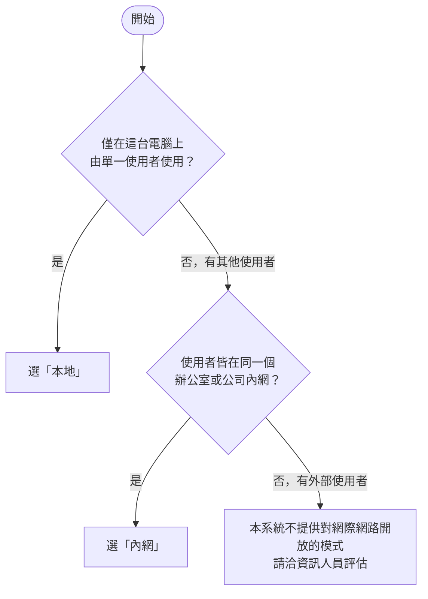

本頁說明從零開始安裝 Open-PETs 的完整流程，不需程式背景，約需 15～30 分鐘。每個步驟均列出操作內容與預期結果。


安裝所需的映像檔編號為 **`2.0.0-rc5`**（不含開頭的 v）。下列指令已包含此編號，可依序執行。


## 名詞說明

| 詞 | 意思 |
| --- | --- |
| **Docker Desktop** | 免費程式，使電腦能執行已封裝的軟體。Open-PETs 透過它執行。 |
| **PowerShell** | Windows 內建的命令列視窗。於開始功能表搜尋「PowerShell」即可開啟。 |
| **IP 位址** | 電腦在網路上的位址，格式如 `192.168.1.20`。其他使用者依此位址連線至主機。 |
| **HTTPS／憑證** | 對傳輸資料加密。網址以 `https://` 開頭。憑證用於讓瀏覽器確認網站身分。 |

## 第 1 步：選擇使用方式



| | 本地 | 內網 |
| --- | --- | --- |
| 適用對象 | 僅安裝者本人 | 同一辦公室、同一內網的多位使用者 |
| 網址 | `http://localhost:8080` | `https://192.168.1.20`（主機的 IP） |
| 使用者端作業 | 不適用 | 每台電腦首次連線前需「信任憑證」（約 2 分鐘） |
| 難度 | ★ | ★★ |


**無法確定時建議選擇「本地」。** 之後可用一行指令改為內網，帳號與資料均會保留。

如需提供公司外部人員使用，涉及網域、憑證與對外開放的資安責任，請洽資訊人員另行評估。


## 第 2 步：安裝 Docker Desktop

1. 至 https://www.docker.com/products/docker-desktop/ 下載並安裝（安裝程式詢問是否使用 WSL 2 時，選擇「是」）。
2. 安裝完成後**重新開機**，再開啟 Docker Desktop。
3. 等待視窗左下角顯示綠色的 **Engine running**（剛開機時可能需要一至兩分鐘）。


公司電腦若不允許自行安裝軟體，請先由資訊人員安裝。Docker Desktop 對個人與小型單位免費，規模較大的組織需購買授權，**請先向資訊人員確認**。


## 第 3 步：下載安裝工具

Open-PETs 提供安裝工具 `open-pets.ps1`，以問答方式完成安裝與模式切換，無須手動修改設定檔。


**請使用全新的資料夾**（下列範例使用 `C:\open-pets-app`）。若這台電腦先前已安裝舊版（資料夾為 `C:\open-pets`），請勿使用同一資料夾，以免覆蓋舊版的金鑰。




開啟 PowerShell，**逐行**貼上並按 Enter：

```powershell
New-Item -ItemType Directory -Force C:\open-pets-app | Out-Null
cd C:\open-pets-app
$v = '2.0.0-rc5'
Invoke-WebRequest -UseBasicParsing "https://github.com/ttcdog115016/Demo/releases/download/v$v/open-pets.ps1" -OutFile open-pets.ps1
Unblock-File .\open-pets.ps1
```

**預期結果：** 沒有錯誤訊息，資料夾內出現 `open-pets.ps1`（輸入 `dir` 可確認）。


```bash
mkdir -p ~/open-pets-app && cd ~/open-pets-app
v=2.0.0-rc5
curl -fsSLO "https://github.com/ttcdog115016/Demo/releases/download/v$v/open-pets.sh"
chmod +x open-pets.sh
```

後續指令中的 `.\open-pets.ps1` 請改為 `./open-pets.sh`，`-Hosts` 等參數改為 `--hosts`。



**出現「已停用指令碼執行，所以無法載入…」時：** 此為 Windows 安全設定。每個指令改以下列方式執行（僅對該次有效，不會變更系統設定）：

```powershell
powershell -ExecutionPolicy Bypass -File .\open-pets.ps1 setup
```

**無網路環境：** 使用「離線交付包」，將整個資料夾複製至主機，於該資料夾開啟 PowerShell（在空白處按住 Shift 並按右鍵，選擇「在此處開啟 PowerShell 視窗」）。資料夾內已含安裝工具與映像檔，無須下載，可直接進行第 4 步。

## 第 4 步：安裝

於安裝資料夾的 PowerShell 執行：

```powershell
.\open-pets.ps1 setup
```

工具會逐題詢問，請依畫面提示回答。首次執行需下載映像檔，約需數分鐘。

### 選擇「本地」（僅安裝者本人使用）

| 工具提問 | 回答 |
| --- | --- |
| 要怎麼使用 | 輸入 `1`，按 Enter |
| 要安裝哪一版（有提問時才需回答） | 輸入 `2.0.0-rc5` |
| 要開始安裝嗎 | 輸入 `Y` |
| 建立管理員：帳號、密碼 | 帳號建議使用 Email。密碼至少 12 個字元，須包含大寫、小寫、數字、符號（輸入時畫面不顯示字元，屬正常現象），並再輸入一次確認 |

**預期結果：**

```text
  [完成] 系統已經就緒

== 怎麼開啟
  在這台電腦的瀏覽器開：http://localhost:8080
```

以 Chrome 或 Edge 開啟 **http://localhost:8080**，使用剛建立的帳號登入。登入後的操作見[前端操作說明](../frontend/)。


若工具顯示「8080 埠已被占用，改用 8081」，網址請改為 `http://localhost:8081`。工具最後的「怎麼開啟」區段會列出正確網址。


### 選擇「內網」（同一辦公室的多位使用者共用）

**開始前請確認：**
- 這台電腦須**持續開機**，並與其他使用者位於**同一個內網**。
- 這台電腦的 **IP 宜固定**（請資訊人員於路由器設定「DHCP 保留」）。IP 變動時，其他使用者將無法連線。

**1. 安裝。** 執行 `.\open-pets.ps1 setup`：

| 工具提問 | 回答 |
| --- | --- |
| 要怎麼使用 | 輸入 `2` |
| 網址（使用者以哪個網址連線） | 工具會列出偵測到的 IP，**按 Enter 即採用第一個**，或輸入指定的位址（例如 `192.168.1.20`）。若另有主機名稱，以逗號接在後面：`192.168.1.20,pets-server` |
| 要開始安裝嗎、建立管理員 | 同「本地」 |

**2. 開放防火牆。** 工具結束時會列出一行 `New-NetFirewallRule ...`。請以系統管理員身分另開 PowerShell（於開始功能表搜尋 PowerShell → 按右鍵 → 以系統管理員身分執行），貼上並執行該行指令。

**3. 產生憑證與使用者說明檔。**

```powershell
.\open-pets.ps1 export-ca
```

**預期結果：**

```text
  [完成] 已匯出憑證：C:\open-pets-app\open-pets-ca.crt
  [完成] 已產生使用者說明檔：C:\open-pets-app\open-pets-user-guide.txt
```

**4. 將兩個檔案提供給使用者**（可透過隨身碟、內部檔案伺服器或 Email）：`open-pets-ca.crt` 與 `open-pets-user-guide.txt`。說明檔內已列出網址與步驟。

**5. 各使用者端各執行一次「信任憑證」。** 原因：憑證由組織內部簽發，瀏覽器預設不認得，因此會顯示警告；信任後即不再顯示。步驟依說明檔進行，摘要如下：

1. 將 `open-pets-ca.crt` 存至本機。
2. 以系統管理員身分開啟 PowerShell，執行 `certutil -addstore -f Root open-pets-ca.crt`。
3. 完全關閉瀏覽器後重新開啟。
4. 於網址列輸入 **`https://192.168.1.20`**（請替換為實際網址），出現鎖頭圖示即完成。


- **網址必須以 `https://` 開頭。** 僅輸入 IP 時，瀏覽器會改用未開放的 `http://`，頁面將持續載入，最後顯示「回應時間過長」。
- **網址須替換為實際使用的網址**，即第 4 步「網址」提問所填入的內容。若不確定，可於安裝資料夾執行 `.\open-pets.ps1 status` 查詢。
- 使用者端沒有系統管理員權限時，請資訊人員以群組原則將 `open-pets-ca.crt` 一次佈署至所有電腦。
- 安裝憑證前，建議核對說明檔中的 SHA-256 指紋（雙擊 `open-pets-ca.crt` →「詳細資料」→「指紋」），一致才安裝，以防檔案遭替換。


## 第 5 步：切換模式

**以一行指令即可切換，資料不會遺失**（帳號、處理紀錄、稽核紀錄、金鑰均存放於 Docker 的「資料磁碟區」）。

```powershell
.\open-pets.ps1 mode local      # 切到本地
.\open-pets.ps1 mode lan        # 切到內網
```

工具會先說明切換後的影響，輸入 `Y` 後才會執行。若新模式需要網址而未提供，工具會詢問。切換完成後，以 `.\open-pets.ps1 status` 確認。

| 切換 | 結果 | 需執行的作業 |
| --- | --- | --- |
| 本地 → 內網 | 其他使用者可透過 `https://內網IP` 連線 | 開放防火牆；執行 `export-ca` 並提供檔案給使用者；使用者端信任憑證 |
| 內網 → 本地 | 其他使用者**立即無法連線**，僅這台電腦可使用 | 事先通知使用者。日後切回內網時沿用原憑證，使用者無須重新信任 |

**舊版安裝的資料夾（`.env` 設有 `OPEN_PETS_MODE=online`）：** 工具會提示改用 `.\open-pets.ps1 mode lan -Hosts 內網IP`（或 `mode local`），資料不會遺失；若直接以 `OPEN_PETS_MODE=online` 啟動新版映像檔，亦會被拒絕，並顯示修正方式。

**網址或 IP 變動時**（例如更換網路）：

```powershell
.\open-pets.ps1 mode lan -Hosts 新IP,舊IP
.\open-pets.ps1 export-ca
```

新舊 IP 均列入，切換回原網路時仍可使用。根憑證不會改變，使用者無須重新信任。

## 日常指令

均於安裝資料夾的 PowerShell 執行（Linux 請將 `.\open-pets.ps1` 改為 `./open-pets.sh`）。

| 需求 | 指令 |
| --- | --- |
| 查看目前的模式、狀態、網址 | `.\open-pets.ps1 status` |
| 暫時停止（資料保留） | `.\open-pets.ps1 stop` |
| 重新啟動 | `.\open-pets.ps1 start` |
| 建立管理員 | `.\open-pets.ps1 create-admin` |
| 管理員忘記密碼 | `.\open-pets.ps1 reset-password` |
| 一般使用者忘記密碼 | 由管理員登入網頁，至「系統設定 → 帳號與權限管理」重設 |
| 備份（建議定期執行） | `.\open-pets.ps1 backup`（備份存放於 `backups` 資料夾，內含帳號與金鑰，須列為機密保管） |
| 更新至新的版本號 | `.\open-pets.ps1 update 新版本號`（更新前自動備份） |
| 產生憑證與使用者說明檔（內網） | `.\open-pets.ps1 export-ca` |
| 查看錯誤原因 | `.\open-pets.ps1 logs` |
| 查看全部指令 | `.\open-pets.ps1 help` |

## 疑難排解

| 現象 | 原因 | 處理方式 |
| --- | --- | --- |
| 「已停用指令碼執行」 | Windows 安全設定 | 指令改為 `powershell -ExecutionPolicy Bypass -File .\open-pets.ps1 指令`（見第 3 步） |
| 「Docker 沒有在執行」 | Docker Desktop 未開啟，或尚未就緒 | 開啟 Docker Desktop，待顯示綠色 Engine running 後重新執行 |
| 「找不到 Docker」 | 尚未安裝 | 回到第 2 步 |
| 「下載映像檔失敗」 | 無法連線網路，或編號輸入錯誤 | 確認網路連線；編號填入 `2.0.0-rc5`（不含開頭的 v） |
| 瀏覽器無法開啟網址 | 埠已變更，或系統尚未就緒 | 執行 `.\open-pets.ps1 status` 查詢正確網址 |
| 登入頁沒有可選的帳號 | 尚未建立管理員 | 執行 `.\open-pets.ps1 create-admin` |
| 登入失敗次數過多而被鎖定 | 180 秒內失敗 5 次會鎖定 15 分鐘 | 等待 15 分鐘，或由管理員重設密碼 |
| 工具執行到一半中止 | 執行過程被中斷 | 重新執行同一指令，工具會接續進行，不會重複建立 |
| （內網）瀏覽器顯示「您的連線不是私人連線」 | 該電腦尚未信任憑證 | 依第 4 步「內網」的第 5 點執行一次 |
| （內網）頁面持續載入，最後顯示 `ERR_CONNECTION_TIMED_OUT` | **網址未以 `https://` 開頭**；或防火牆未開放、主機未開機、使用者端與主機不在同一網路（行動熱點常隔離連線裝置） | 先確認輸入的是 `https://主機IP`。仍無法連線時，於使用者端 PowerShell 執行 `Test-NetConnection 主機IP -Port 443`，應顯示 `TcpTestSucceeded : True`；顯示 `False` 表示網路不通 |
| （內網）更換網路後無法連線 | 主機 IP 已變動，設定仍指向舊 IP | 以 `ipconfig` 查詢新 IP，再執行上方「網址或 IP 變動時」的兩行指令 |
| （內網）出現 `ERR_SSL_PROTOCOL_ERROR` 或憑證名稱不符 | 輸入的網址不在設定的清單內 | 執行 `.\open-pets.ps1 mode lan -Hosts 網址1,網址2`（列入所有會使用的網址），再執行 `export-ca` |
| （內網）工具顯示「443 埠已被占用，HTTPS 改用 8443」 | 這台電腦的 443 埠已被其他程式使用 | 非錯誤。網址須加上埠號：`https://主機IP:8443`，防火牆亦須開放 8443 |
| 工具顯示已有名為「open-pets」的容器 | 這台電腦先前已安裝舊版 | 非錯誤，工具會自動避開，不會變動舊的容器 |

其他問題請見[常見問題](../faq/)。需資訊人員協助時，請提供 `.\open-pets.ps1 logs` 的最後數行輸出。

---

**後續閱讀：** [前端操作說明](../frontend/)（登入後的去識別化操作）、[安裝教學（完整參考）](../deploy/)（供資訊人員：手動設定、備份驗證、授權）、[常見問題](../faq/)。
