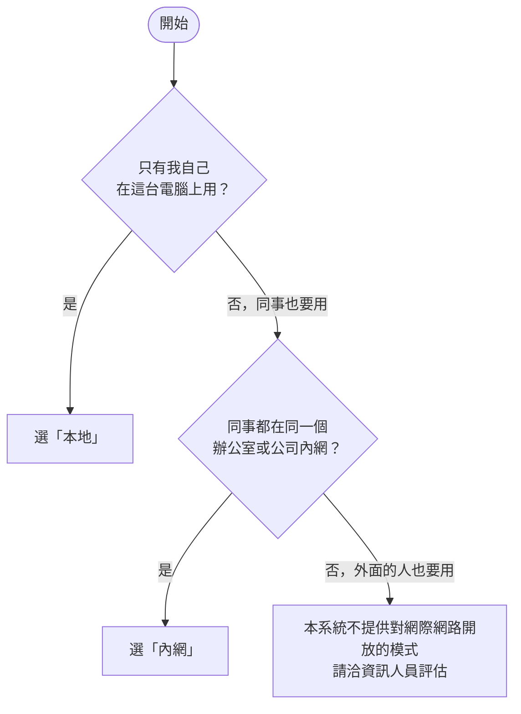

這一頁教你**從零開始**把 Open-PETs 裝好。不需要懂程式，照著做，約 15～30 分鐘。每一步都會告訴你「做什麼」和「應該看到什麼」。


目前最新版本是預發版 **`2.0.0-rc4`**（正式版尚未發佈）。下面的指令已經寫好這個版本，直接複製貼上就好。


## 先看這 4 個詞

| 詞 | 意思 |
| --- | --- |
| **Docker Desktop** | 一個免費程式，讓電腦能執行打包好的軟體。Open-PETs 靠它執行。 |
| **PowerShell** | Windows 內建的「打字下指令」視窗。開始功能表搜尋「PowerShell」就找得到。 |
| **IP 位址** | 電腦在網路上的門牌號碼，長得像 `192.168.1.20`。同事靠它找到你的電腦。 |
| **HTTPS／憑證** | 讓傳送的資料加密。網址以 `https://` 開頭。憑證像身分證，瀏覽器靠它確認網站是真的。 |

## 第 1 步：選一種使用方式



| | 本地 | 內網 |
| --- | --- | --- |
| 誰用 | 只有你自己 | 同辦公室、同內網的同事 |
| 網址 | `http://localhost:8080` | `https://192.168.1.20`（你電腦的 IP） |
| 同事要做 | 不適用 | 每台電腦第一次要「信任憑證」（約 2 分鐘） |
| 難度 | ★ | ★★ |


**不確定就選「本地」。** 之後一行指令就能改成內網，帳號與資料都會保留。

本系統**沒有**對網際網路開放的「線上」模式（已移除）：要讓公司外面的人使用，涉及網域、憑證與對外開放的資安責任，請洽資訊人員另行評估。


## 第 2 步：安裝 Docker Desktop

1. 到 https://www.docker.com/products/docker-desktop/ 下載並安裝（若問你要不要用 WSL 2，選「是」）。
2. 安裝完**重新開機**，再開啟 Docker Desktop。
3. 等視窗左下角變成綠色的 **Engine running**（剛開機可能要等一兩分鐘）。


公司電腦如果不能自己裝軟體，請先請資訊人員安裝。Docker Desktop 對個人與小型單位免費，較大的公司需要付費授權，**請先向資訊人員確認**。


## 第 3 步：下載安裝工具

Open-PETs 附一個小工具 `open-pets.ps1`，用問答幫你安裝與切換模式，不用自己改設定檔。


**請用全新的資料夾**（下面用 `C:\open-pets-app`）。如果這台電腦之前裝過舊版（資料夾叫 `C:\open-pets`），不要用同一個，以免覆蓋舊版的金鑰。




開啟 PowerShell，**一行一行**貼上並按 Enter：

```powershell
New-Item -ItemType Directory -Force C:\open-pets-app | Out-Null
cd C:\open-pets-app
$v = '2.0.0-rc4'
Invoke-WebRequest -UseBasicParsing "https://github.com/ttcdog115016/Demo/releases/download/v$v/open-pets.ps1" -OutFile open-pets.ps1
Unblock-File .\open-pets.ps1
```

**應該看到：** 沒有錯誤訊息，資料夾裡多了 `open-pets.ps1`（輸入 `dir` 可以看到）。


```bash
mkdir -p ~/open-pets-app && cd ~/open-pets-app
v=2.0.0-rc4
curl -fsSLO "https://github.com/ttcdog115016/Demo/releases/download/v$v/open-pets.sh"
chmod +x open-pets.sh
```

之後把指令裡的 `.\open-pets.ps1` 換成 `./open-pets.sh`，`-Hosts` 這類參數換成 `--hosts`。



**出現「已停用指令碼執行，所以無法載入…」？** 這是 Windows 的安全設定。每個指令改成這樣寫（只對那一次有效，不會改系統設定）：

```powershell
powershell -ExecutionPolicy Bypass -File .\open-pets.ps1 setup
```

**沒有網路？** 拿「離線交付包」，整個資料夾複製過來，在該資料夾開 PowerShell（空白處按住 Shift＋右鍵 →「在此處開啟 PowerShell 視窗」）。裡面已有工具與映像檔，不用下載，直接做第 4 步。

## 第 4 步：安裝

在安裝資料夾的 PowerShell 執行：

```powershell
.\open-pets.ps1 setup
```

工具會一題一題問你，**照畫面回答**就好。第一次要下載映像檔，需要幾分鐘，請耐心等。

### 選「本地」（只有你自己用）

| 工具問你 | 回答 |
| --- | --- |
| 要怎麼使用 | 輸入 `1`，按 Enter |
| 要安裝哪一版（有問才答） | 輸入 `2.0.0-rc4` |
| 要開始安裝嗎 | 輸入 `Y` |
| 建立管理員：帳號、密碼 | 帳號建議用 Email。密碼至少 12 個字元，要有大寫、小寫、數字、符號（輸入時畫面不顯示字，是正常的），再輸入一次確認 |

**應該看到：**

```text
  [完成] 系統已經就緒

== 怎麼開啟
  在這台電腦的瀏覽器開：http://localhost:8080
```

用 Chrome 或 Edge 開 **http://localhost:8080**，以剛建立的帳號登入。登入後怎麼用，見[前端操作說明](../frontend/)。


如果工具說「8080 埠已被占用，改用 8081」，網址就改成 `http://localhost:8081`。工具最後一段「怎麼開啟」會寫出正確網址。


### 選「內網」（同辦公室的同事一起用）

**開始前先確認：**
- 這台電腦要**一直開機**，並和同事在**同一個內網**。
- 這台電腦的 **IP 最好固定**（請資訊人員在路由器設「DHCP 保留」）。IP 變了，同事就連不上。

**1. 安裝。** 執行 `.\open-pets.ps1 setup`：

| 工具問你 | 回答 |
| --- | --- |
| 要怎麼使用 | 輸入 `2` |
| 網址（同事用哪個網址連進來） | 工具會列出偵測到的 IP，**直接按 Enter 用第一個**，或輸入你要的（例如 `192.168.1.20`）。也有主機名稱的話，用逗號接在後面：`192.168.1.20,pets-server` |
| 要開始安裝嗎、建立管理員 | 同本地 |

**2. 開放防火牆。** 工具最後會印出一行 `New-NetFirewallRule ...`。用「系統管理員身分」另開一個 PowerShell（開始功能表搜尋 PowerShell → 右鍵 → 以系統管理員身分執行），把那一行貼上執行。

**3. 產生憑證與給同事的說明。**

```powershell
.\open-pets.ps1 export-ca
```

**應該看到：**

```text
  [完成] 已匯出憑證：C:\open-pets-app\open-pets-ca.crt
  [完成] 已產生給同事的說明：C:\open-pets-app\open-pets-colleague-guide.txt
```

**4. 把這兩個檔案交給同事**（隨身碟、內部檔案伺服器、Email 都可以）：`open-pets-ca.crt` 和 `open-pets-colleague-guide.txt`。說明檔裡已經寫好網址與步驟。

**5. 同事各做一次「信任憑證」。** 為什麼要做：憑證是公司內部自己簽發的，瀏覽器一開始不認識，所以會跳警告。信任後就不會再跳。同事照說明檔做，大意是：

1. 把 `open-pets-ca.crt` 存到自己的電腦。
2. 用系統管理員身分開 PowerShell，執行 `certutil -addstore -f Root open-pets-ca.crt`。
3. 完全關閉瀏覽器再重開。
4. 在網址列輸入 **`https://192.168.1.20`**（換成你的網址），出現鎖頭就成功。


- **網址一定要打 `https://`。** 只打 IP 的話，瀏覽器會改走沒有開放的 `http://`，畫面會一直轉圈，最後顯示「回應時間過長」。
- **網址要換成你自己的**：就是第 4 步回答「網址」那題填的。忘了就在安裝資料夾執行 `.\open-pets.ps1 status`，會列出來。
- 同事沒有系統管理員權限：請資訊人員用群組原則把 `open-pets-ca.crt` 一次佈署到所有電腦。
- 同事安裝前，請他核對說明檔裡的 SHA-256 指紋（雙擊 `open-pets-ca.crt` →「詳細資料」→「指紋」），一致才安裝，避免檔案被掉包。


## 第 5 步：切換模式

**一行指令就能切換，資料不會不見**（帳號、處理紀錄、稽核紀錄、金鑰都存在 Docker 的「資料磁碟區」）。

```powershell
.\open-pets.ps1 mode local      # 切到本地
.\open-pets.ps1 mode lan        # 切到內網
```

工具會先用白話告訴你「切換後會發生什麼」，輸入 `Y` 才會執行。新模式需要網址而你沒給時，工具會問你。切換完用 `.\open-pets.ps1 status` 確認。

| 切換 | 會發生什麼 | 你要做什麼 |
| --- | --- | --- |
| 本地 → 內網 | 同事可以用 `https://內網IP` 連進來 | 開防火牆；`export-ca` 給同事；同事信任憑證 |
| 內網 → 本地 | 同事**馬上連不上**，只剩這台電腦能用 | 先通知同事。日後切回內網，憑證沿用，同事不用重新信任 |

**原本用「線上」模式安裝的資料夾**：線上模式已移除，新版不支援。工具會提示你改用 `.\open-pets.ps1 mode lan -Hosts 內網IP`（或 `mode local`），資料不會不見；直接把新版映像檔設成 `OPEN_PETS_MODE=online` 啟動也會被拒絕，並說明要怎麼改。

**網址或 IP 變了**（例如換到另一個網路）：

```powershell
.\open-pets.ps1 mode lan -Hosts 新IP,舊IP
.\open-pets.ps1 export-ca
```

兩個 IP 都列，換回去也能用。根憑證不會變，同事**不用**重新信任。

## 日常指令

都在安裝資料夾的 PowerShell 執行（Linux 把 `.\open-pets.ps1` 換成 `./open-pets.sh`）。

| 我想要 | 指令 |
| --- | --- |
| 看現在的模式、狀態、網址 | `.\open-pets.ps1 status` |
| 暫時停止（資料保留） | `.\open-pets.ps1 stop` |
| 重新啟動 | `.\open-pets.ps1 start` |
| 建立管理員 | `.\open-pets.ps1 create-admin` |
| 忘記管理員密碼 | `.\open-pets.ps1 reset-password` |
| 一般使用者忘記密碼 | 請管理員登入網頁，到「系統設定 → 帳號與權限管理」重設 |
| 備份（建議定期做） | `.\open-pets.ps1 backup`（備份在 `backups` 資料夾，內有帳號與金鑰，請當機密保管） |
| 更新到新版 | `.\open-pets.ps1 update 新版本號`（更新前自動備份） |
| 給同事憑證與說明（內網） | `.\open-pets.ps1 export-ca` |
| 出問題時看原因 | `.\open-pets.ps1 logs` |
| 看全部指令 | `.\open-pets.ps1 help` |

## 遇到問題

| 你看到 | 原因 | 怎麼辦 |
| --- | --- | --- |
| 「已停用指令碼執行」 | Windows 安全設定 | 指令改成 `powershell -ExecutionPolicy Bypass -File .\open-pets.ps1 指令`（見第 3 步） |
| 「Docker 沒有在執行」 | Docker Desktop 沒開，或還沒準備好 | 開啟 Docker Desktop，等綠色 Engine running，再重跑 |
| 「找不到 Docker」 | 還沒安裝 | 回到第 2 步 |
| 「下載映像檔失敗」 | 沒有網路，或版本號打錯 | 確認能上網；版本填 `2.0.0-rc4`（不含開頭的 v） |
| 瀏覽器打不開網址 | 埠被改了，或系統還沒就緒 | `.\open-pets.ps1 status` 看正確網址 |
| 登入頁沒有帳號可選 | 還沒建立管理員 | `.\open-pets.ps1 create-admin` |
| 登入失敗太多次被鎖住 | 180 秒內失敗 5 次會鎖 15 分鐘 | 等 15 分鐘，或請管理員重設密碼 |
| 工具跑到一半停了 | 中途被中斷 | 重新執行同一個指令，工具會接著做，不會重複建立 |
| （內網）瀏覽器顯示「您的連線不是私人連線」 | 這台電腦還沒信任憑證 | 照第 4 步「內網」的第 5 點做一次 |
| （內網）一直轉圈，最後顯示 `ERR_CONNECTION_TIMED_OUT` | **網址沒打 `https://`**；或防火牆沒開、這台電腦沒開機、同事的電腦不在同一個網路（手機行動熱點常會隔離裝置） | 先確認輸入的是 `https://你的IP`。還不行：在同事電腦的 PowerShell 執行 `Test-NetConnection 你的IP -Port 443`，要顯示 `TcpTestSucceeded : True`；顯示 `False` 就是網路不通 |
| （內網）換了網路後連不上 | 電腦的 IP 變了，設定只認舊 IP | 用 `ipconfig` 查新 IP，再執行上面「網址或 IP 變了」那兩行 |
| （內網）出現 `ERR_SSL_PROTOCOL_ERROR` 或憑證名稱不符 | 輸入的網址不在你填的清單裡 | `.\open-pets.ps1 mode lan -Hosts 網址1,網址2`（把會用的都列進去），再 `export-ca` |
| （內網）工具說「443 埠已被占用，HTTPS 改用 8443」 | 這台電腦的 443 被別的程式用了 | 不是錯誤。網址要加埠：`https://你的IP:8443`，防火牆也開 8443 |
| 工具說已有一個叫「open-pets」的容器 | 這台電腦之前裝過舊版 | 不是錯誤，工具會自動避開，不會動到舊的 |

其他問題看[常見問題](../faq/)。要請資訊人員協助時，把 `.\open-pets.ps1 logs` 的最後幾行給他。

---

**接下來可以看：** [前端操作說明](../frontend/)（登入後怎麼做去識別化）、[安裝教學（完整參考）](../deploy/)（給資訊人員：手動設定、備份驗證、授權）、[常見問題](../faq/)。
